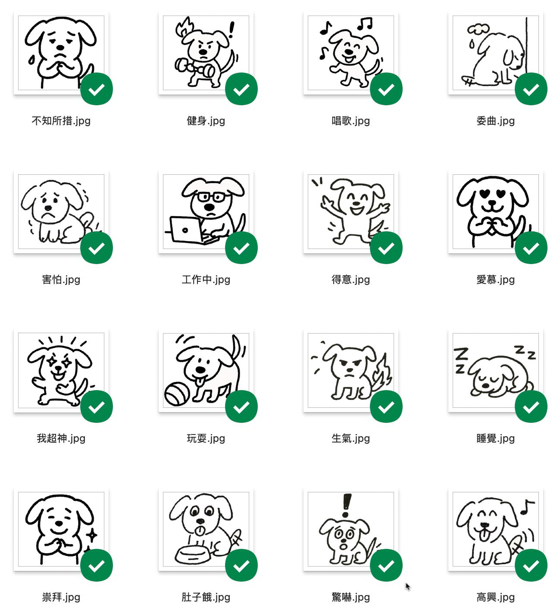

#+title: LINE貼圖創作
#+AUTHOR: 顏永進
#+PROPERTY: header-args :eval never-export
#+TAGS: Python
#+EXCLUDE_TAGS: noexport
#+OPTIONS: toc:0 ^:nil
#+LATEX:\newpage
#+HTML_HEAD: <link rel="stylesheet" type="text/css" href="../css/muse.css" />
#+HTML_HEAD_EXTRA: 
#+begin_export html

#+end_export

* 作品: Kiddoodle Doggo

A playful puppy full of big emotions! With a fun hand-drawn style perfect for adding cuteness and charm to your chats.

#+CAPTION: 20250329
#+LABEL:fig:Labl
#+name: fig:Name
#+ATTR_LATEX: :width 300
#+ATTR_ORG: :width 300
#+ATTR_HTML: :width 500

